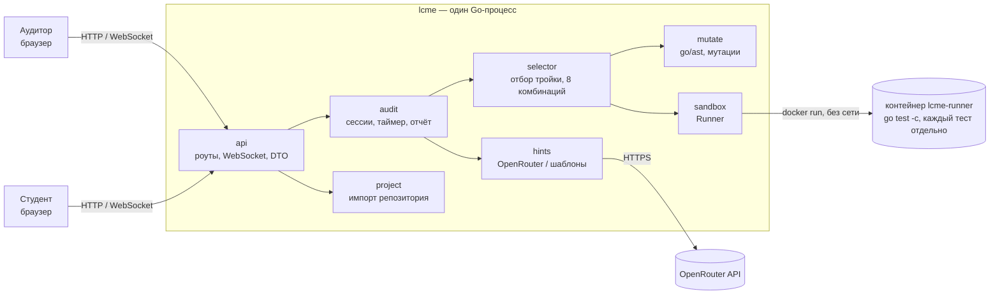

# Live Code Mutation Engine

**ИИ-аудитор понимания кода для P2P-аудитов Tomorrow School.** Система берёт Go-проект студента, вносит в него три проверенные логические ошибки и даёт студенту 10 минут, чтобы найти и исправить их без LLM. Аудитор в это время видит всё вживую и в конце получает отчёт.

Кейс 3 хакатона BRIDGERS STARTUP CHALLENGE (Караганда, 6 ноября 2026).

---

## Проблема

На P2P-аудите студент может показать рабочий проект, который за него написал ИИ, и не понимать, как он устроен. Проверка «запускается — значит понимает» этого не ловит.

## Решение

Проверяем не то, что код работает, а то, что автор умеет в нём ориентироваться:

1. **Аудитор** вставляет ссылку на git-репозиторий студента (или выбирает демо-проект).
2. **Система** находит в коде условия, циклы и выражения и создаёт кандидатов-мутаций: `<` → `<=`, `==` → `!=`, `&&` → `||`, `++` → `--`, константа +1 и т. д.
3. До 64 кандидатов, распределённых между функциями, прогоняются на тестах студента в изолированной песочнице. Выборка меняется между сессиями. В задание попадают только мутации, **для которых есть падающий тест**, то есть доказанно меняющие поведение.
4. Из них выбирается тройка, которую можно проверить по отдельности: прогоняются все **8 комбинаций** «есть/нет» для трёх мутаций, и у каждой мутации должен быть тест, который падает только из-за неё.
5. **Студент** получает изменённый проект в браузерном редакторе (Monaco) после запуска серверного таймера на 10 минут. Он запускает тесты, отмечает строки «здесь ошибка» и исправляет.
6. **Аудитор** видит правки вживую (diff: мутированная версия ↔ текущий код студента), результаты тестов и отметки. Он подтверждает, к какой мутации относится отметка и принято ли объяснение.
7. **Отчёт** по каждой мутации: обнаружена (аудитор привязал отметку) / объяснение принято / исправлена (проходят тесты, ловившие именно её; подходит любое корректное решение) / проект восстановлен / время первого успешного исправления. Отметки можно разобрать после завершения. Сбой среды отображается как недоступная оценка; аудитор может повторить финальную проверку замороженного кода.

ИИ (LLM) используется только на стороне аудитора: объясняет каждую мутацию и предлагает вопрос студенту. Студент LLM не видит.

---

## Архитектура

Один Go-бинарник: HTTP API, WebSocket и собранный React-интерфейс (встроен через `go:embed`). Чужой код запускается только в Docker-контейнере без сети.



| Пакет | Ответственность |
|---|---|
| `cmd/server` | Конфигурация из переменных окружения, сборка зависимостей, запуск HTTP |
| `cmd/runner` | Работает **внутри контейнера**: собирает тестовый бинарник каждого варианта один раз, запускает каждый тест отдельным процессом, печатает JSON |
| `internal/project` | Импорт публичного GitHub в ограниченном контейнере, проверка архива и `go.mod` (без внешних зависимостей) |
| `internal/mutate` | Поиск кандидатов через `go/parser` + `go/ast`, замена байтов по смещениям (форматирование студента не меняется) |
| `internal/sandbox` | Интерфейс `Runner`: `DockerRunner` (прод) и `LocalRunner` (тесты и разработка) |
| `internal/selector` | Зелёный оригинал 3 раза подряд → прогон кандидатов → рейтинг → тройка с проверкой 8 комбинаций |
| `internal/audit` | Сессия, состояния, серверный таймер 10 минут, отметки, прогоны, события, отчёт, хранение в JSON |
| `internal/hints` | Объяснения и вопросы для аудитора: OpenRouter, при ошибке или без ключа — шаблоны |
| `internal/api` | REST + WebSocket, разные представления для аудитора и студента |
| `web/` | React + TypeScript + Vite + Monaco: старт, аудитор, студент, отчёт |

### Почему так

- **Каждый тест в отдельном процессе.** Паника в одном Go-тесте роняет весь тестовый бинарник пакета, и остальные тесты не выполняются. На прототипе при обычном `go test` независимость подтвердилась только у 18 из 40 троек мутаций, а при раздельном запуске — у 40 из 40.
- **Замена байтов, а не `go/printer`.** Принтер переформатировал бы весь файл. Замена по смещениям меняет ровно одну строку.
- **WebSocket, а не SSE.** Одно постоянное двустороннее соединение передаёт изменения кода и события сессии; Caddy проксирует его на VPS через WSS.
- **Состояние в JSON-файлах.** Нет CGO и миграций, сессии переживают перезапуск.

---

## Безопасность

Код из чужого репозитория запускается только так:

```bash
docker run --rm \
  --network none \
  --cap-drop ALL \
  --security-opt no-new-privileges \
  --read-only --log-driver none \
  --tmpfs /tmp:rw,exec,nosuid,nodev,size=268435456,mode=1777 \
  -u 65534:65534 \
  --cpus 2 --memory 1g --memory-swap 1g --pids-limit 512 \
  --mount type=bind,src=<папка задания>,dst=/work,readonly \
  lcme-runner:latest lcme-runner -dir /work -ids <варианты>
```

- Docker-сокет и ключ OpenRouter в контейнер не передаются.
- Таймаут на каждый тест 2 с, на весь контейнер 180 с при подготовке и 60 с при прогоне студента. Вывод каждого теста обрезается до 4 КиБ.
- Импорт: только `https://github.com/владелец/репозиторий`. Отдельный `lcme-importer` работает без сети, с 1 CPU, 256 МиБ RAM без swap и 64 МиБ временного диска. Единственный канал скачивания — ограниченный CONNECT-прокси к публичному IPv4 `github.com:443`; перенаправления и host Git credentials запрещены. Извлекается не больше 2000 файлов и 20 МиБ, `.git` не выдаётся, ссылки и опасные пути отклоняются.
- Публичный API допускает две тяжёлые операции одновременно, включая максимум одну подготовку: второе место остаётся для прогонов. Создание ограничено шестью успешными запросами в минуту на весь сервер; хранятся максимум 64 сессии, переполнение возвращает 429/503. Подготовка ограничена тремя минутами. Финальный прогон при занятости ждёт следующего серверного тика; исходное время завершения сохраняется.
- Неактивные сессии автоматически удаляются: неудачная подготовка через 15 минут, ожидающая старта через 2 часа, завершённая через сутки. Идущие аудиты и прогоны не удаляются. Нужные отчёты сохраняйте до истечения срока. На сессию допускается 100 отметок, 1000 событий и 8 WebSocket-подключений; текст отметки — до 4096 байт.
- Успех теста требует корректного завершения ожидаемого теста, а не только exit code или текста stdout. Это не защищённая аттестация против намеренной подделки тестов: студент может менять вспомогательный код, включая assertion-хелперы, или атаковать память/дескрипторы тестового процесса. Аудитор проверяет diff и объяснение; зелёные тесты сами по себе не доказывают добросовестность.
- Студенту никогда не уходят: список мутаций, оригинальный код, подсказки, «ловящие» тесты, `.git`. Файлы `*_test.go` у студента только для чтения, а перед каждым прогоном сервер подставляет свои копии.
- Уход со вкладки и вставки из буфера записываются как **сигналы для аудитора, а не доказательства** использования LLM.

---

## Стек

| Слой | Технологии |
|---|---|
| Бэкенд | Go 1.24+, стандартная библиотека (`net/http`, `go/ast`, `go/parser`, `go/token`), `github.com/coder/websocket` |
| Песочница | Docker, образ `lcme-runner` на базе `golang:<версия>-alpine` с прогретым кэшем сборки |
| Фронтенд | React 18, TypeScript, Vite, `@monaco-editor/react` (Editor + DiffEditor), `react-router-dom`, `qrcode.react` |
| LLM | OpenRouter (API в формате OpenAI Chat Completions), модель задаётся переменной окружения |
| Основной хостинг | Отдельный DigitalOcean VPS: Ubuntu 22.04, Docker, systemd и Caddy HTTPS |
| Локальная разработка | Windows 11 + WSL2 Ubuntu + Docker Desktop (интеграция с WSL) |

---

## Публичный проект

**[Открыть проект](https://mutagen-178-62-254-165.sslip.io)** — приложение и Docker-песочницы работают на выделенном VPS DigitalOcean. Адрес сохраняется при перезапуске VPS, пока существует сервер с этим IPv4.

Службы `lcme`, `docker` и `caddy` запускаются автоматически; Caddy обслуживает HTTPS, данные сессий хранятся на диске сервера. Проверены внешний сценарий с ИИ-подсказками, импорт GitHub, обе роли и восстановление после reboot между прогонами. Последняя проверенная выкладка описана в [plans.md](plans.md), DEPLOY-1. Исправления FIX-1–FIX-4 требуют отдельного обновления VPS: публикация исходников в GitHub сама сервер не обновляет.

## Сборка и проверка проекта

### Требования

- Linux amd64 и Docker. Команды сборки выполняются в Linux-окружении.
- Go 1.24+ (`go version`), Node.js 20+ (`node -v`), `git`, `make`.

### Сборка

```bash
git clone https://github.com/Ak1tava/Live-Code-Mutation-Engine---.git lcme
cd lcme
cp .env.example .env          # при желании впишите OPENROUTER_API_KEY и LCME_LLM_MODEL

make image    # собирает lcme-runner и lcme-importer
make web      # собирает фронтенд в web/dist
make build    # собирает bin/lcme (фронтенд встроен)
```

Рядом с бинарником при запуске нужен каталог `examples/textkit`; путь считается от рабочего каталога. Шаблоны служб находятся в `deploy/`, секреты в них не включаются.

### Эксплуатация VPS

На сервере `178.62.254.165` приложение запускает systemd-сервис `lcme`; HTTPS обслуживает Caddy. Команды управления выполняются на VPS через SSH:

```bash
systemctl status lcme caddy docker --no-pager
curl --fail https://mutagen-178-62-254-165.sslip.io/healthz
```

Настройки находятся в `/etc/lcme.env` (0600): `LCME_RUNNER=docker`, `LCME_ADDR=127.0.0.1:8080`, `LCME_PUBLIC_URL=https://mutagen-178-62-254-165.sslip.io`. Состояние хранится в `/var/lib/lcme/data`. После изменения конфигурации выполнить `systemctl restart lcme` между сессиями. Секреты и данные сессий не добавлять в Git.

### Тесты

```bash
make test           # unit + интеграция с LocalRunner (без Docker)
make test-docker    # те же сценарии через Docker + проверки изоляции (нет сети, uid 65534)
```

### Режим разработки

```bash
make dev            # собирает бинарники, запускает LocalRunner для textkit и Vite на :5173
```

### Переменные окружения

| Переменная | По умолчанию | Назначение |
|---|---|---|
| `LCME_ADDR` | `:8080` | Адрес HTTP-сервера |
| `LCME_PUBLIC_URL` | `http://localhost:8080` | Внешний адрес для ссылок и QR-кода |
| `LCME_DATA_DIR` | `./data` | JSON-файлы сессий |
| `LCME_WORK_DIR` | `./work` | Временные копии проектов и вариантов |
| `LCME_RUNNER` | `docker` | `docker` или `local` (`local` — только для разработки, запускает чужой код без изоляции) |
| `LCME_RUNNER_IMAGE` | `lcme-runner:latest` | Образ песочницы |
| `LCME_RUNNER_BIN` | `./bin/lcme-runner` | Бинарник раннера для `local` |
| `OPENROUTER_API_KEY` | пусто | Ключ OpenRouter. Без него подсказки шаблонные |
| `LCME_LLM_MODEL` | пусто | ID модели с openrouter.ai/models (нужен вместе с ключом) |

---

## Структура репозитория

```
cmd/server/          точка входа сервера
cmd/runner/          раннер внутри контейнера
internal/project/    импорт репозитория
internal/mutate/     мутации через go/ast
internal/sandbox/    Runner: Docker и Local, JSON-протокол
internal/selector/   отбор тройки, проверка 8 комбинаций
internal/audit/      сессии, таймер, отчёт, хранение
internal/hints/      OpenRouter и шаблоны
internal/api/        HTTP + WebSocket
web/                 React + TS + Vite + Monaco
sandbox/Dockerfile   образ lcme-runner
examples/textkit/    встроенный демо-проект
plans.md             план реализации
```

---

## Ограничения MVP

- Только Go. Проект — Go-модуль с тестами `go test`, без внешних зависимостей в `go.mod` (в учебных проектах школы обычно разрешена только стандартная библиотека).
- Только публичные репозитории GitHub; URL без параметров, пароля и перенаправлений.
- Версия `go` в `go.mod` проекта не может быть новее Go в образе песочницы, иначе импорт отклоняется с понятной ошибкой.
- Если подходящей тройки мутаций нет (мало тестов, всё в одной функции), подготовка честно завершается отказом с объяснением.
- Бюджет отбора — 64 кандидата; отказ не доказывает отсутствие подходящей тройки среди всех возможных мутаций. Generated-код, неактивные build tags и файлы больше 256 КиБ не мутируются. Skip не считается успешно выполненным тестом, а запись в каталог проекта запрещена песочницей; используйте `t.TempDir()`.
- Прошедшие тесты подтверждают исправление только на тех сценариях, которые эти тесты проверяют.
- Случайность уменьшает повторяемость заданий, но открытое создание аудитов не предотвращает предварительное изучение проекта. Сохранение и рассылка пока содержат полный снимок; большие проекты могут замедлять совместную работу.
- Запретить LLM студенту невозможно технически. Система делает уход со вкладки и вставки видимыми для аудитора, а решение остаётся за человеком.

---

## Использование ИИ при разработке

Для анализа кейса, проектирования, написания кода и проверок использовались Claude Code и OpenAI Codex; отдельные независимые ревью выполнялись моделью Astra, что отражено в `plans.md`. Прототип движка и гипотезы о маскировании паникой и независимости троек проверялись запуском. В продукте подсказки аудитору генерируются через OpenRouter выбранной моделью; без ключа используются шаблоны. Код и результаты автоматических проверок подлежат разбору командой.

## Локальная проверка без Docker

Для разработки на доверенном встроенном `textkit`:

```bash
make demo
# http://127.0.0.1:8080
```

Нужны Go 1.24+, Node.js 20+ и npm. Если Go установлен в `~/.local/go`,
добавьте его в PATH: `export PATH="$HOME/.local/go/bin:$PATH"`.
`make demo` собирает интерфейс и оба бинарника. Для Vite с обновлением
интерфейса используйте `make dev` (страница на `http://localhost:5173`).

В режиме `local` сервер принимает только встроенный `textkit`, отклоняет
импорт URL и слушает loopback. Это режим разработки: запускаемые правки
не изолированы, поэтому этот режим нельзя публиковать в интернете или
давать недоверенным пользователям. Для работы с репозиториями нужен Docker.
По умолчанию `make run` по-прежнему использует Docker.

```bash
make test
(cd examples/textkit && go test ./...)
go vet ./...
(cd web && npm run typecheck && npm test && npm run build)
```

Подсказки без ключа формируются по шаблонам. Интеграция OpenRouter проверяется
локальным HTTP-сервером в тестах; реальные обращения требуют ключа и модели.
Студент получает только сводный результат сессии, а подробности мутаций
и объяснения доступны аудитору.
